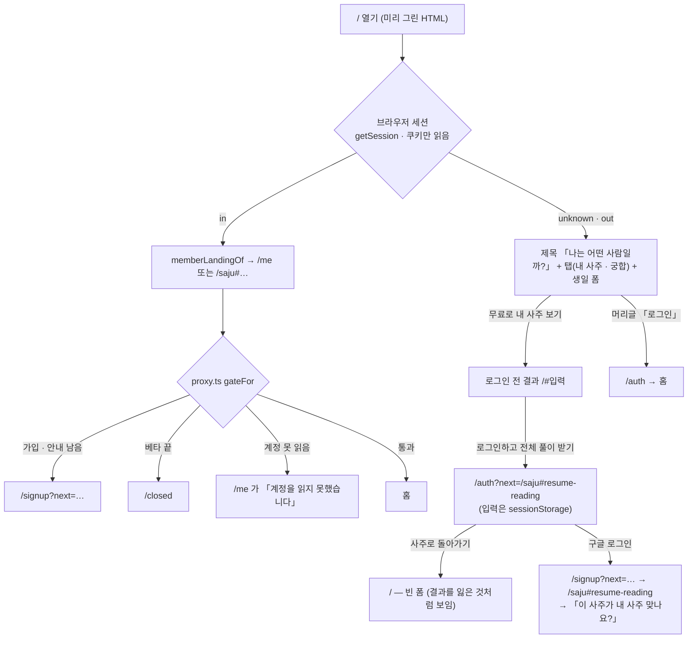
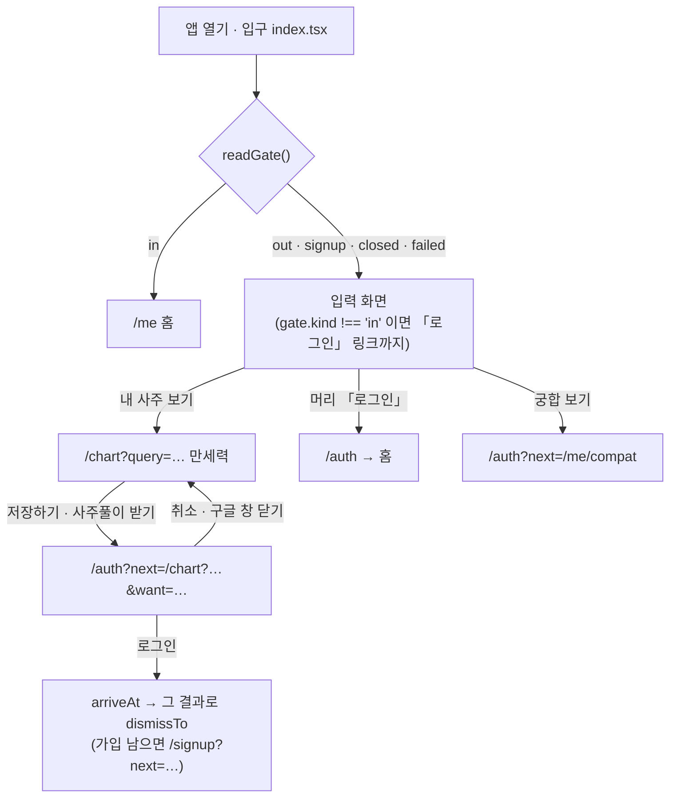

# 첫 화면은 지금의 폼 그대로이고 주 단추 아래에 「이미 계정이 있으신가요? 로그인」 한 줄을 더한다 — 앱은 상태를 못 읽으면 로그인 전으로 읽지 않는다

> **운영자 결정 2026-11-05**(조율자가 옮김, PR #1009) — 웹과 앱의 첫 진입을 다듬는다: 로그인하지 않은 사람은 로그인 없이 사주를 보고, 이미 쓰는 사람은
> 생년월일을 다시 적지 않고 로그인한다. 같은 날 소개 화면(서비스 설명 · 결과 예시 · 「로그인 없이 사주 보기」)을 세워 보았으나 운영자가 **지금의 첫 화면을 그대로 두는 쪽**을 골랐다(아래 「고르지 않은 것」).
> 결정 점검표의 「누가 무엇을 볼 수 있는가」(화면 문구 · 입구)와 「실패했을 때 열리는가 닫히는가」(앱 상태 실패)에 걸린다. 수집 · 보유 · 동의 · 연령 · 풀이권 · 회원 공개 범위는 그대로다.
> 문구는 대장 first-04 「확인 전」이다.

## 잰 것 (2026-11-05, main `49c2c76b`, 문서가 아니라 코드)

### 지금 — 웹



### 지금 — 앱



- 앱의 `readGate` 가 `failed`(계정 · 일정을 못 읽음, 15초 시한)이거나 `signup`(가입 · 안내 확인이 남음)이어도 입구는 **로그인 전 입력 화면**을 세우고
  「로그인」을 보였다(`setSignedIn(gate.kind === 'in')`). 로그인한 회원이 망이 흔들린 한 번에 로그인 전 화면을 보고, 다시 로그인하거나 생년월일을 다시 적게 됐다.
  가짜 서버(`down` · `unsigned`)로 재 보니 둘 다 그 화면이었다.
- 이미 쓰는 사람의 길은 웹 머리글 · 앱 머리 오른쪽의 「로그인」 하나였다 — 폼을 채우려는 눈길 밖이다.
- 웹은 상태 확인이 실패해도 로그인 전으로 읽지 않는다 — 세션은 쿠키 읽기라 망이 안 들고, 계정 · 일정을 못 읽은 것은 `gateFor` 가 「안 보냄」으로 두고 화면이 그 까닭을 말한다(ADR 0078). 고칠 것이 없었다.
- 웹 로그인 화면 · 로그인 실패의 출구 「사주로 돌아가기」는 늘 `/` 였다 — 결과에서 사주풀이를 누르고 온 사람이 그만두면 빈 폼에 섰다(입력은 `sessionStorage` 에 남아 있었다).

## 정한 것

### 새 흐름 — 웹 · 앱 (바뀐 칸만)

```diff
 웹 / (로그인 전)
   제목 · 탭(내 사주 · 궁합) · 생일 폼
   [무료로 내 사주 보기]
+  이미 계정이 있으신가요? [로그인] → /auth → 홈        (세션이 없다고 안 뒤에만, 결과가 서기 전에만)
 웹 /auth?next=/saju#resume-reading
-  사주로 돌아가기 → /
+  사주로 돌아가기 → /#resume-reading → 그 결과로 복원   (로그인 실패 화면도 같다)

 앱 입구 readGate() → entryFor
   in      → /me
-  out · signup · closed · failed → 로그인 전 입력 화면
+  closed  → /me (껍데기가 /closed 로)
+  signup  → /signup
+  failed  → 「계정을 확인하지 못했어요.」 · [다시 시도하기]
+  out     → 입력 화면
   제목 「나는 어떤 사람일까?」
-  내 사주를 읽고, 궁금한 사람과의 궁합을 살펴보세요. · 인연은 어떻게 찾나요? → · 궁합 보기 →
+  [내 사주 보기 | 궁합 보기]   ← 웹 / 의 그 탭 모양
+    내 사주 보기: 생일 폼 · [무료로 내 사주 보기] · 이미 계정이 있으신가요? [로그인]
+    궁합 보기:   궁합풀이는 로그인하면 볼 수 있어요 · 가입하면 풀이권으로 궁합풀이를 받을 수 있어요. · [로그인하고 궁합풀이 받기] → /auth?next=/me/compat
-  [내 사주 보기]
```

1. **첫 화면은 지금 그대로다** — 웹 `/` 는 제목 · 「내 사주 보기 / 궁합 보기」 탭 · 생일 폼, 앱은 입력 화면. 앞에 소개 화면을 두지 않는다.
2. **주 단추 바로 아래에 이미 쓰는 사람의 한 줄**(`MEMBER_SIGN_IN_ASK` + 「로그인」) — 웹 · 앱 같은 글자, `/auth` 로 가서 목적지 기본값(홈)에 선다. 생년월일을 묻지 않는다.
   웹은 세션이 없다고 **안 뒤에만** 세운다(회원에게 한 번 깜빡이지 않게) · 결과가 선 뒤에는 결과의 로그인 단추가 그 일을 해서 걷는다. 머리글 · 앱 머리의 「로그인」은 그대로다(웹 · 앱 둘 다 있다).
3. **앱 첫 화면의 머리는 웹 `/` 와 같다**(운영자 2026-11-05) — 제목 아래는 「내 사주 보기 / 궁합 보기」 두 탭이다. 웹 `home-hero.tsx` 의 탭과 같은 면(`rounded-cell` 의 꺼진 판 · 켜진 칸은 흰 면과 `shadow-card` · 해와 태극 그림 · 웹의 탭 글자)을 디자인 원본(`@design` 의 `RADIUS` · `COLOR` · `ELEVATION`)으로 세운다.
   - 제목 아래 설명 줄(「내 사주를 읽고, 궁금한 사람과의 궁합을 살펴보세요.」, `ABOUT_LEAD[0]`)과 두 링크(「인연은 어떻게 찾나요? →」 · 「궁합 보기 →」)는 걷는다 — 웹 첫 화면에도 없고, 인연은 닫혀 있다(ADR 0222). `ABOUT_LEAD` 는 서비스 소개의 글로 남는다.
   - **「궁합 보기」 탭** — 앱에는 로그인 전 궁합 결과가 없어(ADR 0213 의 11) 로그인으로 잇는다: 앱 로그인 화면의 궁합 제목(`COMPAT_SIGN_IN_TITLE`) · 웹 로그인 전 궁합 결과의 풀이권 줄(`COMPAT_CREDIT_NOTE`)과 단추(`COMPAT_SIGN_IN_ACTION`) — 모두 있던 글자이고 웹 `pair-taste.tsx` 가 같은 상수를 읽는다.
     갈 곳은 지금의 궁합 로그인 길(`/auth?next=/me/compat`)이다. 풀이권의 수는 적지 않는다 — 궁합풀이는 한 편에 풀이권 1장을 쓰고(약관 제15조), 새 회원의 무료 몫은 #1012 에서 바뀐다. 이 탭에는 「이미 계정이 있으신가요? 로그인」을 두지 않는다 — 주 단추가 곧 로그인이다.
     적던 생일은 탭을 오가도 남는다(웹처럼 숨길 뿐 내려 두지 않는다).
   - 앱 주 단추는 웹과 같은 「무료로 내 사주 보기」다 — 「내 사주 보기」였던 문서상 까닭이 없었다(대장 first-01 은 걷은 앱 소개의 입구 글자를 옮겼다고만 적었다).
4. **앱 입구는 관문의 답 하나로 고른다**(`src/lib/consent/entry.ts` 의 `entryFor`) — 회원 · 끝난 베타는 홈, 가입 · 안내가 남았으면 가입 화면, 세션이 없으면 입력 화면,
   **못 읽었으면 다시 시도하기**다. 「다시 시도하기」는 껍데기(`/me` 의 `failed`)와 같은 글자 · 같은 줄(`UNREACHABLE`)이다. 회원의 「다른 사람 사주 보기」(`another`)는 관문의 답과 상관없이 입력 화면이다.
5. **로그인을 그만두면 그 결과로 돌아간다.** 웹 로그인 화면과 로그인 실패 화면의 「사주로 돌아가기」는 사주 이어 보기를 든 사람에게 `/#resume-reading` 이다(`visitorExitOf`) — 첫 화면이 남은 입력으로 결과를 다시 세운다(ADR 0144 의 7).
   그 밖은 `/` 다. 앱은 이미 그랬다(ADR 0213 추기 — 취소는 그 결과).
6. **로그인만으로 풀이권을 쓰거나 풀이를 시작하지 않는다** — ADR 0213 의 6 · ADR 0028 그대로다. 이 결정은 길을 가리키는 것만 바꾼다. 새 서버 호출 · 새 문 · 마이그레이션이 없다.

## 궁합 입구가 웹과 앱에서 다른 것 — 그대로 둔다

- 웹은 로그인 없이 궁합 첫 신호(엔진의 한 줄 · 가린 점수, ADR 0131 의 5)를 「궁합 보기」 탭에서 보이고, 궁합풀이에서 로그인을 묻는다. 앱은 같은 모양의 「궁합 보기」 탭이 로그인 안내와 단추를 세우고 `/auth?next=/me/compat` 으로 잇는다(ADR 0213 의 11, 위 3).
- **권고: 이 차이를 지금 없애지 않는다.** 앱에 로그인 전 궁합 화면을 세우는 일은 새 화면 · 새 문구 · 두 사람 입력 폼(앱에는 아직 없음)이고 작지 않다. 웹에서 첫 신호를 걷는 일은 운영 중인 기능을 줄인다.
  앱 로그인 화면의 제목 「궁합풀이는 로그인하면 볼 수 있어요」가 까닭을 말한다. 앱에 로그인 전 궁합을 넣을지는 간극 대장의 일로 남긴다(G-136).

## 고르지 않은 것 (같은 날 세워 보고 운영자가 걷은 것 — PR #1009 의 앞 판들)

- **폼 앞의 소개 화면** — 제목 · 한 줄 · 결과 예시 · 「로그인 없이 볼 수 있는 것」 · 「로그인 없이 사주 보기」 · 「이미 이용 중인가요? 로그인」, 체험은 웹 `/#start` · 앱 `/?start=1`. 처음 온 사람이 폼까지 한 번 더 눌러야 했다. 운영자가 지금의 첫 화면을 골랐다.
- **소개의 예시 카드 세 꼴** — ① 엔진이 계산한 사주 카드에 기둥 줄을 더한 것 ② 사주풀이 글의 일부(표지 비유 · 첫 절) ③ 회원 홈의 내 사주 카드를 예시 값과 예시 비유로 채운 것. 소개와 함께 걷었다.
- **「이미 이용 중인가요?」** — 운영자가 어색하다고 봤다. 실사례의 「이미 … 계정이 있…요?」 꼴로 바꿨다(대장 first-04).
- **첫 화면 앞에 설명 슬라이드를 두는 것** — 지시가 막았고, 실사례 근거도 없다(`docs/notes/2026-11-02-korean-app-flow-references.md` 1).
- **앱의 상태 실패를 로그인 전 화면 + 작은 경고로 두는 것** — 회원이 「로그인」을 보고 다시 로그인하게 된다.

## 실패했을 때

| 자리 | 답 |
| --- | --- |
| 앱 — 관문을 못 읽음 | 다시 시도하기. 로그인 전 화면을 세우지 않는다 |
| 웹 — 계정 · 일정을 못 읽음 | 지금 그대로 — `/me` 가 그 까닭을 말한다(ADR 0078) |
| 웹 — 세션을 아직 모름 | 로그인 줄을 안 세운다(회원에게 안 깜빡인다) |
| 로그인 취소 · 실패 | 웹은 로그인 화면 · 로그인 실패의 출구가 그 결과로, 앱은 지금처럼 그 결과로 |

## 시험

`src/lib/consent/entry.test.ts`(앱 입구의 갈래 — 실패는 다시 시도하기, 가입 남음은 가입 화면) · `src/lib/consent/return-path.test.ts`(로그인을 그만둔 출구) ·
`scripts/mobile-entry-save-copy.test.ts` 「앱 입구」(주 단추 아래 한 줄 · 웹과 같은 글자 · 설명 줄 · 인연 입구 없음 · 웹 모양의 두 탭 · 궁합 탭의 글자와 길 · 관문의 답) · `scripts/mobile-surfaces.test.ts`(탭 칸 그림자의 예외) ·
e2e `e2e/auth.spec.ts` 「사주 계산은 로그인 없이 열리고…」(주 단추 아래 줄 · `/auth`) · `e2e/taste.spec.ts` 의 로그인 취소 복귀.
구글 로그인 · 실기기 · 실제 DB 는 재지 않았다 — 앱은 Expo 웹 번들과 가짜 서버(`mobile/scripts/measure/fake-server.mjs`)로 쟀다.
