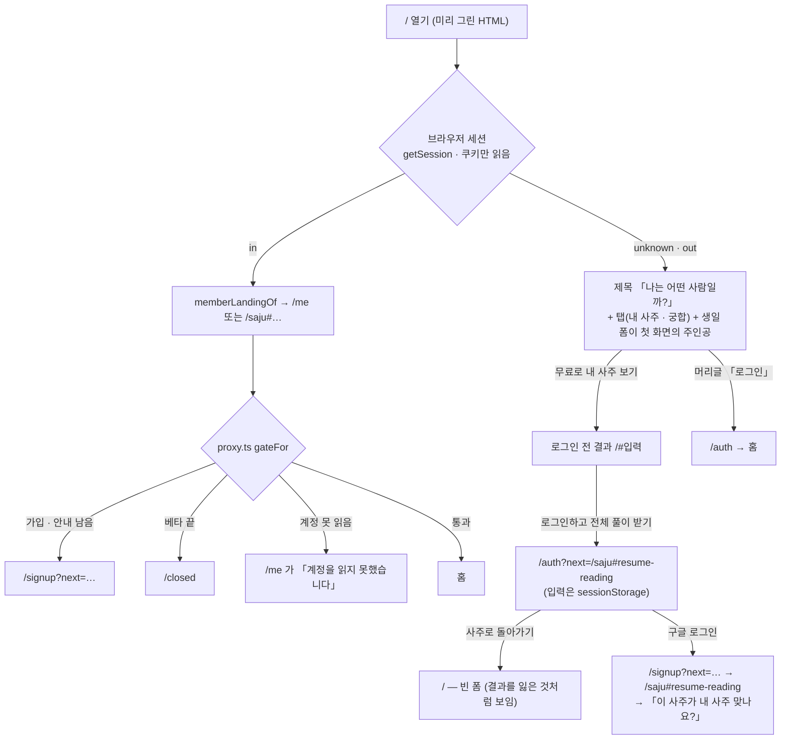
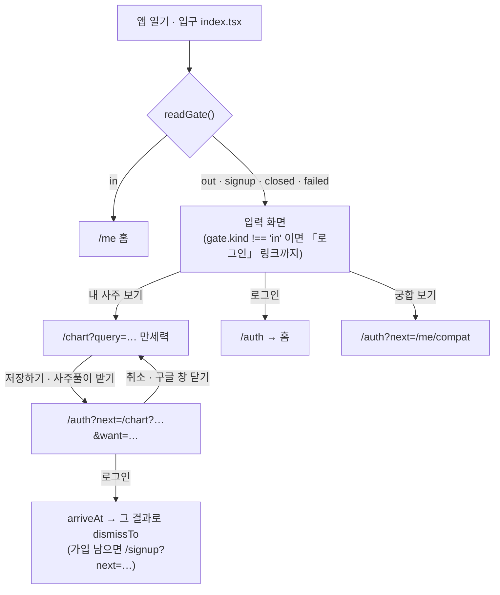
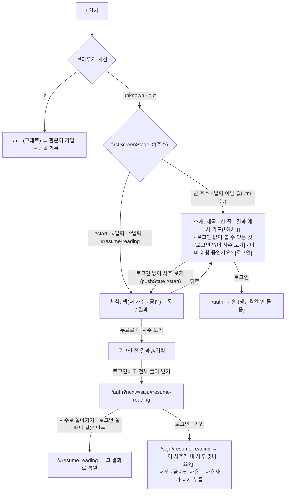
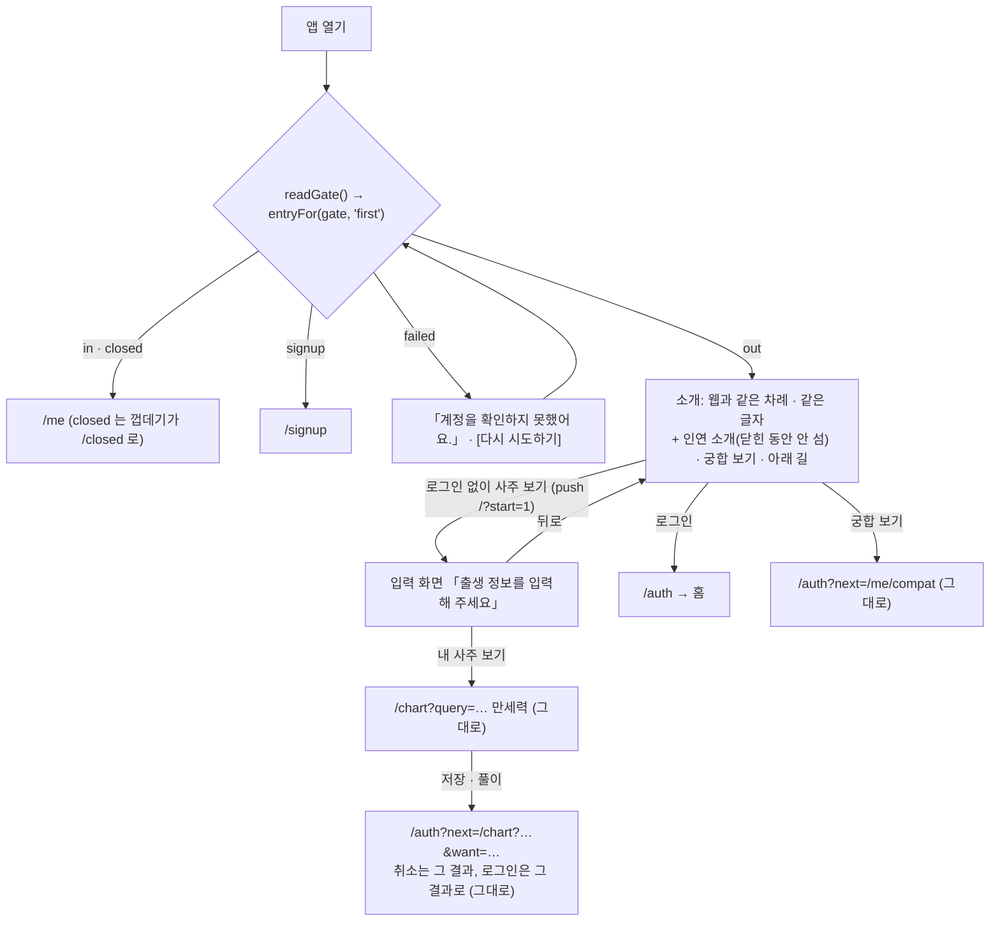

# 첫 화면은 무엇을 하는 곳인지 먼저 보이고, 「로그인 없이 사주 보기」와 「이미 이용 중인가요? 로그인」 두 입구를 가른다 — 앱은 상태를 못 읽으면 로그인 전으로 읽지 않는다

> **운영자 지시 2026-11-05**(조율자가 옮김) — 웹과 앱의 첫 진입을 고친다: 로그인하지 않은 사람은 폼보다 먼저 서비스가 무엇인지 보고, 로그인 없이 사주를 해 보고,
> 이미 쓰는 사람은 생년월일을 다시 적지 않고 로그인한다. 결정 점검표의 「누가 무엇을 볼 수 있는가」(화면의 갈래)와 「실패했을 때 열리는가 닫히는가」에 걸린다.
> 이 결정은 ADR 0144 덧(2026-10-08)이 적은 운영자 판단 「폼이 첫 화면에 한 번에 보이는 쪽」과 ADR 0213 · PRD §3.1 의 「앱의 로그인 전 입구는 입력 화면 하나」(#940)를 대체한다.
> 수집 · 보유 · 동의 · 연령 · 풀이권 · 회원 공개 범위는 그대로다. 문구는 대장 first-04 「확인 전」이다.

## 잰 것 (2026-11-05, main `49c2c76b`, 문서가 아니라 코드)

### 지금 — 웹

### 지금 — 앱

- 앱의 `readGate` 가 `failed`(계정 · 일정을 못 읽음, 15초 시한)이거나 `signup`(가입 · 안내 확인이 남음)이어도 입구는 **로그인 전 입력 화면**을 세우고
  「로그인」을 보였다(`setSignedIn(gate.kind === 'in')`). 로그인한 회원이 망이 흔들린 한 번에 로그인 전 화면을 보고, 다시 로그인하거나 생년월일을 다시 적게 됐다.
  가짜 서버(`down` · `unsigned`)로 재 보니 둘 다 그 화면이었다 — 전후 그림은 PR 에 있다.
- 웹의 첫 화면은 폼이 주인공이었다 — 제목 아래 곧장 탭과 폼. 무엇을 보게 되는지는 폼을 채운 뒤에야 보였다. 「할 수 있는 것」은 폼 아래, 폰에서는 두 화면 아래였다.
- 웹은 상태 확인이 실패해도 로그인 전으로 읽지 않는다 — 세션은 쿠키 읽기라 망이 안 들고, 계정 · 일정을 못 읽은 것은 `gateFor` 가 「안 보냄」으로 두고 화면이 그 까닭을 말한다(ADR 0078). 고칠 것이 없었다.
- 웹의 로그인 화면 출구 「사주로 돌아가기」는 늘 `/` 였다 — 결과에서 사주풀이를 누르고 온 사람이 그만두면 빈 폼에 섰다(입력은 `sessionStorage` 에 남아 있었다). 브라우저의 뒤로 가기만 결과로 돌아갔다.

## 정한 것

### 새 흐름 — 웹

### 새 흐름 — 앱

1. **첫 화면은 소개가 먼저다.** 웹 `/` 와 앱 입구가 같은 차례 · 같은 글자다 — 제목 「나는 어떤 사람일까?」 → 한 줄(`ABOUT_LEAD` 첫 문장) → **결과 예시**(엔진이 실제로 계산한 사주 카드, 이름 자리에 「예시」)
   → 로그인 없이 볼 수 있는 것 한 줄 → 주 단추 「로그인 없이 사주 보기」 → 「이미 이용 중인가요? 로그인」. 슬라이드도 저절로 넘어가는 소개도 없다. 폼은 소개에 없다.
   - 예시의 생일은 `src/lib/input/example.ts` 의 한 값이고 **폼과 결과를 채우지 않는다**(`DEFAULT_QUERY` 의 「예시 명식으로 채우지 않는다」는 그대로). 카드에는 누를 자리가 없다.
   - 「로그인 없이 볼 수 있는 것」 — 웹은 `SIGNED_OUT_REACH`(사주와 궁합 첫 신호), 앱은 서비스 소개의 「사주」 줄이다. 앱에는 로그인 전 궁합 결과가 없어 웹의 줄이 거짓이 된다(ADR 0213 「로그인 없이 글자」).
2. **체험은 주소에 싣는다.** 웹은 `/#start`(`TRIAL_MARK`), 앱은 `/?start=1` 이 입력 화면을 스택에 올린다 — 폼에서 뒤로 가면 소개다. 웹의 결과 링크 · 옛 `?` 링크 · 로그인을 다녀온 낱말은
   주소만으로 체험이다(`firstScreenStageOf`). 입력이 아닌 값(`?utm_source=…`)은 소개다. 서비스 소개 · 열 수 없는 공유 링크의 「무료로 내 사주 보기」는 체험으로 곧장 간다(`TRIAL_PATH`).
3. **이미 쓰는 사람의 로그인은 홈으로 간다** — 목적지를 싣지 않는다(`signInFrom('/')` 와 같은 답). 생년월일을 묻지 않는다.
4. **앱 입구는 관문의 답 하나로 고른다**(`src/lib/consent/entry.ts` 의 `entryFor`) — 회원 · 끝난 베타는 홈, 가입 · 안내가 남았으면 가입 화면, 세션이 없으면 소개,
   **못 읽었으면 다시 시도하기**다. 「다시 시도하기」는 껍데기(`/me` 의 `failed`)와 같은 글자 · 같은 줄(`UNREACHABLE`)이다. 체험(`start`)과 회원의 「다른 사람 사주 보기」(`another`)는 관문의 답과 상관없이 입력 화면이다.
5. **로그인을 그만두면 그 결과로 돌아간다.** 웹 로그인 화면과 로그인 실패 화면의 「사주로 돌아가기」는 사주 이어 보기를 든 사람에게 `/#resume-reading` 이다(`visitorExitOf`) — 첫 화면이 남은 입력으로 결과를 다시 세운다(ADR 0144 의 7).
   그 밖은 첫 화면(소개)이다. 앱은 이미 그랬다(ADR 0213 추기 — 취소는 그 결과).
6. **로그인만으로 풀이권을 쓰거나 풀이를 시작하지 않는다** — ADR 0213 의 6 · ADR 0028 그대로다. 이 결정은 길을 가리키는 것만 바꾼다.
7. **새 서버 호출 · 새 문 · 마이그레이션이 없다.** 예시 카드는 브라우저(웹은 미리 그릴 때) · 기기 안 계산이다.

## 궁합 입구가 웹과 앱에서 다른 것 — 그대로 둔다

- 웹은 로그인 없이 궁합 첫 신호(엔진의 한 줄 · 가린 점수, ADR 0131 의 5)를 체험 안 「궁합 보기」 탭에서 보이고, 궁합풀이에서 로그인을 묻는다. 앱은 소개의 「궁합 보기」가 곧장 `/auth?next=/me/compat` 이다(ADR 0213 의 11).
- **권고: 이 차이를 지금 없애지 않는다.** 앱에 로그인 전 궁합 화면을 세우는 일은 새 화면 · 새 문구 · 두 사람 입력 폼(앱에는 아직 없음)이고 작지 않다. 반대로 웹에서 첫 신호를 걷는 일은 운영 중인 기능을 줄인다.
  대신 **각 화면이 자기 조건만 말한다** — 웹 소개는 「사주와 궁합 첫 신호는 로그인 없이」, 앱 소개는 「사주」 줄만 세우고 궁합 입구는 로그인 화면의 제목 「궁합풀이는 로그인하면 볼 수 있어요」가 까닭을 말한다.
  앱에 로그인 전 궁합을 넣을지는 간극 대장의 일로 남긴다(G-136).

## 고르지 않은 것

- **첫 화면 앞에 설명 슬라이드를 두는 것** — 지시가 막았고, 실사례 근거도 없다(`docs/notes/2026-11-02-korean-app-flow-references.md` 1).
- **체험을 새 주소(`/start`)로 두는 것** — 웹은 미리 그린 `/` 의 계산기 · 이어 보기 복원 · 결과 링크가 `/` 의 `#` 뒤에 산다. 새 주소는 그 길을 모두 옮기거나 둘로 나눈다. `#start` 는 계산기가 빈 폼으로 읽는다.
- **앱의 상태 실패를 로그인 전 화면 + 작은 경고로 두는 것** — 회원이 「로그인」을 보고 다시 로그인하게 된다. 지시가 막았다.
- **예시를 그림 파일로 두는 것** — 카드 모양이 바뀔 때 그림만 옛 모양으로 남는다. 엔진이 그리는 카드는 늘 지금 모양이다.

## 치르는 값

- 웹의 결과 링크(`/#입력`)로 온 사람은 미리 그린 HTML 의 소개를 한 틱 본 뒤 결과로 바뀐다 — 전에는 빈 폼이 한 틱 섰다. 주소의 `#` 뒤는 서버에 안 온다(ADR 0007).
- 처음 온 사람은 폼까지 한 번 더 누른다. 지시가 고른 값이다.

## 실패했을 때

| 자리 | 답 |
| --- | --- |
| 앱 — 관문을 못 읽음 | 다시 시도하기. 로그인 전 화면을 세우지 않는다 |
| 웹 — 계정 · 일정을 못 읽음 | 지금 그대로 — `/me` 가 그 까닭을 말한다(ADR 0078) |
| 예시 계산이 실패 | 카드만 안 선다(시험이 그 값의 계산을 잰다) |
| 로그인 취소 · 실패 | 웹은 로그인 화면 · 로그인 실패의 출구가 그 결과로, 앱은 지금처럼 그 결과로 |

## 시험

`src/lib/consent/entry.test.ts`(앱 입구의 갈래 — 실패는 다시 시도하기) · `app/saju-landing.test.ts`(소개 · 체험의 갈래, 체험 표식) · `src/lib/consent/return-path.test.ts`(로그인을 그만둔 출구) ·
`src/lib/input/example.test.ts`(예시는 계산되고 폼은 비어 있다) · `scripts/mobile-entry-save-copy.test.ts` 「앱 입구」 · `scripts/mobile-shell-copy.test.ts`(앱 소개의 글자가 웹에 있다) ·
e2e `e2e/taste.spec.ts` 「첫 화면은 소개 · 결과 예시 · 두 입구…」 · 같은 파일의 로그인 취소 복귀 · `e2e/auth.spec.ts` · `e2e/reading-entry.spec.ts` · `e2e/saju.spec.ts`(`openTrial`).
구글 로그인 · 실기기 · 실제 DB 는 재지 않았다 — 앱은 Expo 웹 번들과 가짜 서버(`mobile/scripts/measure/fake-server.mjs`)로 쟀다.
