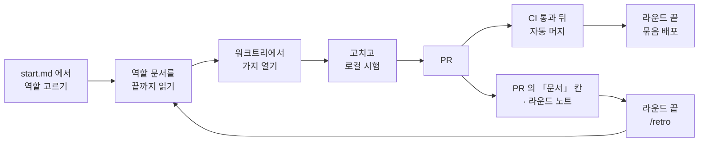

# 사람을 위한 안내 — 이 저장소를 처음 (또는 오랜만에) 여는 분께

> **이 문서는 사람을 위한 것이에요.** 에이전트는 이 문서를 읽지 않아도 되고, 어떤 역할 문서도 이 문서를 가리키지 않아요.
> 여기에는 규칙이 없어요 — 무엇을 어디서 찾는지와 낯선 말의 뜻만 있어요. 규칙은 각 절이 링크하는 **원본 문서**에 있어요.
> **이 문서와 원본이 다르면 원본이 맞아요.**

저장소의 문서는 대부분 에이전트가 빨리 읽도록 짧고 촘촘한 말투로 적혀 있어요. 「잰 값」 · 「문」 · 「든다」 · 「붉은 main」
같은 말이 설명 없이 나와요. 몇 주 만에 돌아왔거나 처음 함께하는 분은 이 문서부터 읽고, 모르는 말은 맨 아래
[사내 용어 풀이표](#6-사내-용어-풀이표)에서 찾아보세요.

## 1. 이 저장소가 일하는 방식 한눈에

### 누가 일하나요

| 누구 | 하는 일 |
| --- | --- |
| **운영자** | 사람이에요. 서비스의 주인이고 결정을 내려요. 무엇을 운영자가 답하거나 직접 하는지는 [권한 등급](agents/delegation/permissions.md)과 [결정 점검표](agents/delegation/decisions.md)가 정해요. |
| **조율자** | 운영자와 대화하는 AI 세션이에요. 역할 에이전트에게 일을 맡기고, 질문을 모아 운영자에게 묻고, 머지 순서를 정해요. ([조율자 역할](roles/coordinator.md)) |
| **역할 에이전트** | 실제로 고치는 AI 에이전트예요. 맡은 일의 종류에 따라 역할 하나를 받아요 — 역할 목록은 [`docs/start.md` 「역할 고르기」](start.md#역할-고르기) |

### 어느 문서가 무엇을 답하나요

한 사실은 한 문서에만 적어요. 어느 문서가 어느 질문의 원본인지, 그리고 문서와 코드 · 시험이 어긋나면 어느 쪽이 맞는지는
[`docs/start.md` 「원본」 표](start.md#원본--무엇이-무엇을-답하나)가 정리해 둬요. 문서에 적힌 코드 규칙은 대부분 「어느 날 재 보니
이랬다」는 기록(「잰 값」)이고, 중요한 것은 시험 · 린트가 지켜요(「잠금」, [ADR 0086](adr/0086-the-code-rules-are-measured-then-held-by-lint-and-tests.md)).

## 2. 일의 흐름 — 선순환

일 하나가 시작돼서 운영에 나가고 문서로 돌아오기까지의 길이에요. 원본은 [`docs/start.md` 「선순환」](start.md#선순환--일이-문서로-돌아오는-길)이에요.

걸음마다 원본은 이래요.

| 걸음 | 원본 |
| --- | --- |
| 시작 전 확인(붉은 main · 나란히 도는 세션) | [`docs/start.md` 「모두가 먼저 보는 것」](start.md) · [시작하기 전에](agents/delegation/working.md) |
| 워크트리 · 스택 자리 · 원격 잠금 | [일하는 법](agents/delegation/working.md) |
| PR 로만 main 에 넣기 · PR 본문의 칸 | [권한 등급](agents/delegation/permissions.md) · [끝났다는 것](agents/delegation/done.md) |
| 머지와 배포 · DB 를 먼저 올리기 | [배포](ops/runbook/deploy.md) · [ADR 0110](adr/0110-merging-is-not-deploying-production-ships-once-per-bundle.md) |
| 머지 뒤 main 검증 · `ci-main-red` | [CI](agents/test-map/ci.md) |
| 문서로 돌아오기 · 라운드 노트 · 돌아보기 | [`docs/start.md` 「선순환」](start.md#선순환--일이-문서로-돌아오는-길) · [세션 기록](agents/delegation/notes.md) |

## 3. 코드의 층 넷과 방향

코드는 네 층으로 나뉘어요. 무엇이 무엇을 불러도 되는지는 [`docs/architecture.md`](architecture.md)가 정하고 린트와
`scripts/layers.test.ts` 가 지켜요.

| 층 | 어디 | 쉬운 설명 |
| --- | --- | --- |
| **엔진** | `src/lib/saju/` | 생년월일시로 사주를 계산하는 순수한 계산기예요. |
| **도메인 lib** | `src/lib/` 의 나머지 폴더 | 풀이 · 매칭 · 동의 같은 업무 판단이에요. |
| **문과 액션** | `app/**/*.ts` | DB 를 실제로 부르는 자리예요. DB 를 읽는 함수를 「문」이라고 불러요. |
| **화면** | `app/**/*.tsx` | 그리는 자리예요. |

## 4. 시험 넷

시험은 네 종류예요 — 단위(vitest) · pgTAP · 흐름 · e2e(Playwright). 각각이 무엇을 보는지는
[시험 넷](agents/test-map/kinds.md), 무엇을 고쳤으면 무엇을 돌리는지(로컬 최소)는
[무엇을 고쳤으면 무엇을 돌리나](agents/test-map/what-to-run.md), CI 가 무엇을 도는지는 [CI](agents/test-map/ci.md)가 정해요.

## 5. 병렬 · 조율 · 권한 — 어디를 여나

| 궁금한 것 | 원본 |
| --- | --- |
| 여러 에이전트가 동시에 일할 때 무엇이 부딪히고 어떻게 나누나 | [나란히 맡길 때](agents/delegation/parallel.md) |
| 운영자가 자는 동안 무엇까지 해도 되나 | [무인 라운드](agents/delegation/unattended.md) 「권한 봉투」 |
| 무엇이 바뀌면 운영자의 「결정」인가 | [결정 점검표](agents/delegation/decisions.md) |
| 무엇을 묻지 않고 하고 무엇은 사람이 답한 뒤인가(등급 0~4) | [권한 등급](agents/delegation/permissions.md) |
| 운영 개인정보는 누가 어떻게 보나 | [접속](ops/runbook/access.md) · [ADR 0105](adr/0105-the-operator-reads-leave-a-trace-from-the-first-read.md) |
| 새 화면 문구는 어떻게 넣고 누가 확인하나 | [화면 문구](agents/code-rules/screen-copy.md) · [문구 대장](product/copy-ledger.md) |

## 6. 사내 용어 풀이표

문서에 자주 나오는데 처음 보면 걸리는 말들이에요. 「어디서 정하나」는 그 말이 처음 정해졌거나 가장 잘 설명된 곳이에요.
제품 낱말(명식 · 원국 · 풀이권 같은)은 [`GLOSSARY.md`](../GLOSSARY.md)에 따로 있어요.

### 동사 — 문서 말투의 버릇

일상어를 좁은 뜻으로 써요. 이 말들만 알아도 문서가 훨씬 잘 읽혀요.

| 말 | 쉬운 뜻 | 예 |
| --- | --- | --- |
| **재다 · 잰 값** | 직접 세거나 실행해서 확인하다 · 그렇게 얻은 측정치. 「잰 값이지 정한 규칙이 아니다」는 「어느 날 코드를 세어 보니 이랬다」는 뜻이에요 | [ADR 0086](adr/0086-the-code-rules-are-measured-then-held-by-lint-and-tests.md), [일하는 법 「재는 법」](agents/delegation/working.md) |
| **든다 · 들다** | ① (문서 · 시험이) 무엇을 담고 있다 · 책임지다 — 「간극 대장이 든다」 ② (PR 이 main 에) 들어가다, 머지되다 — 「main 에 든다」 | 문서 전반 |
| **들이다** | PR 을 main 에 머지해 넣다 | [무인 라운드](agents/delegation/unattended.md) |
| **선다 · 서다** | 존재하고 실제로 동작한다. PRD 에서는 「코드에 있고 시험이나 실호출로 한 번은 밟혔다」는 정해진 표시예요 | [`docs/prd.md`](prd.md) 표시 표 |
| **밟다** | 절차를 실제로 실행하다 · 코드 경로를 실제로 지나가다. 「등급 3 을 밟는다」 = 그 단계를 실행한다 | [권한 등급](agents/delegation/permissions.md) |
| **걷다 · 걷는다** | 없애다, 치우다(기능 · 파일 · 워크트리 · 옛 표를). 「줄을 걷는다」 = 그 줄을 지운다 | 문서 전반 |
| **쥐다** | 끝까지 책임지고 맡다 · 자원을 점유하다. 「한 에이전트는 한 충돌 영역을 쥔다」 | [나란히 맡길 때](agents/delegation/parallel.md) |
| **가르다** | 구분하다, 나누다. 「버그인지 문서 노후인지 가른다」 | [조율자 세션](agents/delegation/coordinator.md) |
| **닿다** | (시험이) 그 코드까지 실제로 실행이 미치다 · (명령이) 운영에 접속하다 | [시험 넷](agents/test-map/kinds.md) |
| **붉다 · 붉힌다 · 빨개진다** | 시험 · CI 가 실패하다 · 실패하게 만들다 | 문서 전반 |
| **초록** | 시험 · CI 가 통과한 상태 | 문서 전반 |
| **올리다** | 운영에 배포하다 · 운영 DB 에 마이그레이션을 적용하다 | [배포](ops/runbook/deploy.md) |
| **묻다 · 답** | 운영자에게 확인을 구하다 · 운영자의 승인. 「「배포」 답」 = 운영자가 배포해도 된다고 한 말 | [조율자 세션](agents/delegation/coordinator.md) |
| **값으로 적는다** | 「했다」고만 쓰지 않고 실제로 본 숫자 · 출력을 적다 | [권한 등급](agents/delegation/permissions.md) |
| **옮겨 적는다** | 다른 문서의 칸 · 문장을 그대로 복사해 채우다 | [끝났다는 것](agents/delegation/done.md) |
| **한 벌 · 두 벌** | 한 세트 · 두 세트. 「진실이 두 벌이 된다」 = 같은 사실이 두 곳에 적혀 어긋날 수 있다 | [조율자 세션](agents/delegation/coordinator.md) |
| **자리** | ① 어떤 일이 있는 곳(파일 · 줄 · 위치) ② 로컬 스택의 슬롯 번호 ③ 사람 목록의 저장 칸. 문맥으로 구분해요 | 문서 전반, [일하는 법](agents/delegation/working.md) |
| **칸 · 줄 · 절** | 표의 열(또는 양식의 항목) · 표의 행 · 문서의 소제목 구역. 「「문서」 칸」 = PR 양식의 「문서」 항목 | 문서 전반 |
| **갈래** | 경우의 수 하나, 분기 | [실패를 말하는 법](agents/code-rules/failures.md) |

### 문서 체계

| 말 | 쉬운 뜻 | 어디서 정하나 |
| --- | --- | --- |
| **원본** | 그 사실을 적는 유일한 문서. 다른 문서는 원본을 가리키기만 해요 | [`docs/start.md` 「원본」](start.md#원본--무엇이-무엇을-답하나) |
| **입구** | 일을 시작할 때 처음 여는 문서, `docs/start.md` | [`docs/start.md`](start.md) |
| **역할 문서** | 역할마다 한 장짜리 길잡이(`docs/roles/`). 칸이 「먼저 읽는 것 · 이 저장소의 방식 · 하지 않는 것 · 끝날 때 고치는 것」이에요 | [ADR 0140](adr/0140-each-role-reads-its-page-first-and-closes-by-fixing-the-docs.md) |
| **길잡이 (Router)** | 규칙을 다시 쓰지 않고 원본의 절을 링크로 가리키는 문서. 역할 문서가 그래요 | [ADR 0145](adr/0145-role-documents-route-to-sources-and-do-not-restate-them.md) |
| **색인 · 주제 파일 · 영역 파일** | 큰 문서를 쪼갠 모양. 색인은 차례 표만 들고, 내용은 그 아래 주제 · 영역별 파일에 있어요. 고칠 자리의 파일만 열어요 | 각 색인 문서 (`docs/prd.md`, `GLOSSARY.md` 등) |
| **읽기량 예상치** | 역할을 받은 에이전트가 손대기 전에 읽는 바이트의 보수적 예상치. 모든 일이 읽는 것은 그대로, 일마다 고르는 것은 가장 큰 후보로 세요. 문턱이 없는 보고라 CI 를 붉히지 않아요 | [ADR 0177](adr/0177-the-read-budget-is-a-report-and-ci-checks-only-the-role-page-and-what-it-points-to.md), `scripts/read-budget.mjs` |
| **PRD** | 제품 요구사항 문서. 제품이 **지금** 무엇을 하는지 적어요 | [`docs/prd.md`](prd.md) |
| **§ (예: PRD §7.0)** | PRD 의 절 번호. 「GLOSSARY §8」처럼 용어집 절에도 써요 | [`docs/prd.md`](prd.md) |
| **선다 · 없다 · 다르다** | PRD 줄마다 붙는 상태 표시 셋 — 있고 확인됨 · 정했지만 아직 없음 · 코드와 문서가 어긋났던 자리 | [`docs/prd.md`](prd.md) |
| **간극 대장** | 「아직 없는 것 · 안 정한 것 · 어긋난 것」의 목록. 상태와 「끝났다고 말할 조건」을 함께 들어요 | [`docs/product/gaps.md`](product/gaps.md), [ADR 0089](adr/0089-the-prd-keeps-the-present-and-the-gaps-live-in-one-ledger.md) |
| **G-nn (예: G-62)** | 간극 대장의 줄 번호 | [`docs/product/gaps.md`](product/gaps.md) |
| **정했다 · 미정 · 어긋남 · 보류 · 결정 대기** | 간극 대장의 상태 다섯 — 할 일로 정함 · 무엇을 할지 안 정함 · 코드와 문서가 다름 · 운영자가 미룸 · 운영자 답이 필요함 | [`docs/product/gaps.md`](product/gaps.md) 머리말 |
| **보류** | 운영자가 미룬 것 | [`docs/product/gaps.md`](product/gaps.md) 머리말 |
| **띠** | 간극 대장의 묶음 — 「언제 닫나」로 나눠요(운영 베타 · 채팅 안전 베타 · 공개 출시 · 정비) | [`docs/product/gaps.md`](product/gaps.md) 머리말 |
| **기록 파일 (`gaps/records/g-nn.md`)** | 간극 대장 한 줄의 긴 증거 · 경과를 담은 파일 | [`docs/product/gaps.md`](product/gaps.md) 머리말 |
| **changelog · 개정 기록** | 날짜별로 무엇이 참이 됐는지의 기록. 끝에 덧붙이기만 해요 | [`docs/product/prd-changelog.md`](product/prd-changelog.md) |
| **ADR NNNN** | 결정 기록(Architecture Decision Record) 번호. 왜 이렇게 정했는지를 담아요 | [`docs/adr/README.md`](adr/README.md) |
| **후속 결정 · 후속 결정(일부)** | 그 ADR 이 다른 ADR 로 통째로 · 일부 대체됐다는 머리 표시 | [Writing an ADR](agents/domain.md#writing-an-adr) |
| **현재 결정 색인** | 영역별로 지금 유효한 ADR 번호만 모은 목록 | [`docs/adr/README.md`](adr/README.md) |
| **용어집** | 제품 낱말의 뜻과 코드 이름을 잇는 문서. 「_Avoid_」는 쓰지 말라는 옛 이름이에요 | [`GLOSSARY.md`](../GLOSSARY.md) |
| **문구 대장** | 이미 승인된 화면 문구의 목록 | [`docs/product/copy-ledger.md`](product/copy-ledger.md) |
| **노트 · 세션 기록 · 라운드 노트** | 그날의 판단과 사정을 남긴 기록(`docs/notes/`). 요구사항도 규칙도 아니에요 | [세션 기록](agents/delegation/notes.md) |
| **prd-archive · US 번호** | 옛 요구사항 문서와 그 안의 사용자 이야기 번호. 코드 주석의 옛 번호를 찾을 때만 써요 | [`docs/start.md`](start.md) |
| **문서 노후 · 결정 미반영** | 코드와 문서가 어긋난 까닭 중 둘 — 문서가 낡음 · 운영자 결정이 아직 문서나 코드에 안 들어감 (나머지 하나는 버그) | [조율자 세션](agents/delegation/coordinator.md) |
| **선순환** | 일을 하며 배운 것이 다시 문서로 돌아오는 고리 | [`docs/start.md` 「선순환」](start.md#선순환--일이-문서로-돌아오는-길) |
| **헤맨 것 · 틀린 절** | 에이전트가 역할 문서에 없어서 찾아다닌 것 · 가리킨 절이 틀렸던 것. 보고에 한 줄 남겨요 | [`docs/start.md` 「선순환」](start.md#선순환--일이-문서로-돌아오는-길) |
| **/retro** | 라운드 끝 돌아보기 스킬. 보고의 「헤맨 것」을 문서 · 시험 · 규칙으로 옮겨요 | [조율자 역할](roles/coordinator.md), [ADR 0146](adr/0146-the-coordinator-runs-retro-at-round-end-instead-of-its-own-loop.md) |

### 일하는 방식 · 조율

| 말 | 쉬운 뜻 | 어디서 정하나 |
| --- | --- | --- |
| **라운드** | 조율자가 여러 에이전트에게 일을 맡기고 머지 · 배포까지 하는 한 바퀴 | [조율자 세션](agents/delegation/coordinator.md) |
| **브리프** | 조율자가 에이전트에게 주는 작업 지시서. 역할 · 정해진 것 · 할 일 · 건드리지 않을 자리 등의 칸이 있어요 | [조율자 세션](agents/delegation/coordinator.md) |
| **차가운 시작** | 에이전트는 이전 대화를 전혀 모른 채 시작한다는 뜻. 그래서 브리프에 필요한 걸 다 적어요 | [조율자 세션](agents/delegation/coordinator.md) |
| **보고** | 에이전트가 끝나고 조율자에게 돌려주는 결과 메시지 | [조율자 세션](agents/delegation/coordinator.md) |
| **확인한 흔적** | 주장에 붙이는 근거 — 직접 본 `파일:줄`이나 실행 결과 | [조율자 세션](agents/delegation/coordinator.md) |
| **가설** | 이슈 · 메모 · 이전 세션이 적은 문장. 재 보기 전에는 사실로 믿지 않아요 | [일하는 법](agents/delegation/working.md) |
| **두 번째 검토** | 이 대화를 모르는 검토 에이전트가 코드와 대조해 보는 것. 위험한 변경에만 붙여요 | [조율자 세션](agents/delegation/coordinator.md) |
| **관점 (여덟)** | 전체 감사 때 검토 에이전트에게 나눠 주는 시각 — 코드 규칙 · 아키텍트 · 시험 · 보안 · DB · 프런트 · 문서 · SRE | [검토 역할](roles/reviewer.md) |
| **무인 라운드** | 운영자가 자는 동안 도는 라운드 | [무인 라운드](agents/delegation/unattended.md) |
| **권한 봉투** | 무인 라운드를 시작할 때 「이번에 무엇까지 해도 되나」를 한 번 적어 둔 범위 | [무인 라운드](agents/delegation/unattended.md) |
| **묶음 (파동)** | 한 번에 머지할 PR 들의 묶음. 순서를 정해 모의 합치기 → 하나씩 머지 → main 확인 → 다음 묶음 | [무인 라운드](agents/delegation/unattended.md) |
| **아침 보고** | 무인 라운드 뒤 운영자에게 주는 정리 — 머지된 것 · 결정 대기 · 돌린 시험 · main 상태 등 | [무인 라운드](agents/delegation/unattended.md) |
| **결정 점검표** | 바뀌면 「결정」이 되는 것들의 목록 | [결정 점검표](agents/delegation/decisions.md) |
| **결정 여부** | PR 「문서」 칸의 첫 줄 — 결정 점검표에 걸리면 「있음」 | [끝났다는 것](agents/delegation/done.md) |
| **PR 칸 여섯** | PR 본문 양식 — 무엇이 참이 되나 · 잰 값 · 돌린 것 · 잠금이면 일부러 어긴 것 · 문서 · 사람이 할 걸음 | [끝났다는 것](agents/delegation/done.md) |
| **잠금이면 일부러 어긴 것** | 새 시험 · 린트를 세웠으면 일부러 규칙을 어겨서 정말 실패하는지 본 기록 | [끝났다는 것](agents/delegation/done.md) |
| **사람이 할 걸음** | 등급 3 이라 운영자가 해야 하는 단계(배포 · 실호출 · 문구 확인 등) | [끝났다는 것](agents/delegation/done.md) |
| **전후 그림** | 화면이 바뀐 PR 에 붙이는 바뀌기 전 · 후 스크린샷 | [끝났다는 것](agents/delegation/done.md) |
| **맡길 이슈 · 칸 아홉** | 에이전트에게 맡길 수 있게 정리된 이슈(`ready-for-agent`)와 그 양식의 항목 아홉 | [맡길 이슈](agents/delegation/issues.md) |
| **운영자 할 일 이슈** | 사람만 할 수 있는 일(계정 · 사업자 정보 · 변호사 등)을 모아 둔 이슈 | [조율자 역할](roles/coordinator.md) |
| **`[변호사 검토 필요]`** | 법무 판단이 필요해 비워 둔 자리 표시 | [조율자 세션](agents/delegation/coordinator.md) |

### 병렬 · 로컬 환경

| 말 | 쉬운 뜻 | 어디서 정하나 |
| --- | --- | --- |
| **워크트리** | 같은 저장소를 다른 폴더에 하나 더 펼친 것(git worktree). 세션마다 따로 써서 서로 안 부딪혀요 | [일하는 법 「저장소와」](agents/delegation/working.md) |
| **로컬 스택** | 내 컴퓨터에서 도는 Supabase 컨테이너 · dev 서버 한 벌 | [나란히 맡길 때](agents/delegation/parallel.md) |
| **스택 자리 (`stack:slot`)** | 워크트리마다 받는 로컬 스택 번호. 이름 · 포트가 겹치지 않게 해요. main 체크아웃은 자리 0 | [ADR 0096](adr/0096-each-worktree-owns-its-stack-and-the-remote-is-one-at-a-time.md) |
| **공유 자원** | 여러 세션이 함께 쓰는 한 벌짜리 것 — 로컬 스택 · 운영 DB · 마이그레이션 순서 · 중앙 문서 · 잠금 시험 · CI · e2e 기반 | [나란히 맡길 때](agents/delegation/parallel.md) |
| **충돌 영역** | 같은 공유 자원을 건드리는 일들의 묶음. 한 에이전트가 끝까지 맡아요 | [나란히 맡길 때](agents/delegation/parallel.md) |
| **병렬 가능 · 순차** | 동시에 해도 됨 · 차례로 해야 함 | [나란히 맡길 때](agents/delegation/parallel.md) |
| **중앙 문서** | 여러 PR 이 함께 고치는 문서(간극 대장 · changelog · PRD · 위임 규약 · 용어집) | [나란히 맡길 때](agents/delegation/parallel.md) |
| **union** | changelog 에 건 git 병합 방식. 두 PR 이 끝에 덧붙인 줄을 둘 다 남겨요 | [나란히 맡길 때](agents/delegation/parallel.md) |
| **strict · BEHIND** | main 보호 규칙의 「최신 main 위에 있어야 머지」 설정 · 가지가 최신 main 을 안 품었다는 PR 상태. 지금 켜졌는지는 원본이 말해요 | [권한 등급](agents/delegation/permissions.md) |
| **모의 합치기 (`merge:sim`)** | 머지할 PR 들을 임시로 차례대로 합쳐 시험을 돌려 보는 것 | [`docs/agents/test-map/what-to-run.md`](agents/test-map/what-to-run.md) |
| **원격 잠금** | 운영 DB 에 닿는 명령이 한 번에 하나만 돌도록 기계 전체에 거는 잠금 | [일하는 법 「저장소와」](agents/delegation/working.md) |
| **키체인 창** | 워크트리에서 운영 CLI 를 처음 부를 때 macOS 가 띄우는 허락 창 | [로컬 환경의 함정](agents/delegation/local-env.md) |

### 권한 · 운영 · 출시 단계

| 말 | 쉬운 뜻 | 어디서 정하나 |
| --- | --- | --- |
| **등급 0~4** | 되돌릴 수 있는지로 나눈 권한 단계. 0 읽기 · 1 로컬 수정 · 2 밖으로 내되 되돌릴 수 있게 · 3 사람이 답한 뒤 · 4 안 함 | [권한 등급](agents/delegation/permissions.md) |
| **등급 3 을 밟고 값을 적는다** | 등급 3 의 일을 한 뒤 본 결과를 기록한다는 뜻. 어느 것을 묻고 어느 것을 묻지 않나는 원본이 정해요 | [ADR 0093](adr/0093-tier-three-locks-turn-on-at-official-operation.md) |
| **공식 운영에 들어가면 켜는 잠금** | 공개 출시에 맞춰 켠 확인 목록 — 도구 설정의 `ask` 와 같은 목록이에요 | [권한 등급](agents/delegation/permissions.md) |
| **운영 베타** | 첫 단계. 테스트 코드로 초대받은 사람이 쓰던 단계예요 | [`docs/product/prd/roadmap.md` §7.0](product/prd/roadmap.md) |
| **(지금)** | 출시 단계 표에서 현재 단계를 가리키는 표시. CI 와 권한 시험이 이 표시를 읽어요 | [`docs/product/prd/roadmap.md` §7.0](product/prd/roadmap.md) |
| **채팅 안전 베타 · 공개 출시** | 운영 베타 다음 단계들. 공개 출시는 테스트 코드 없이 누구나 가입하는 단계예요. 지금 단계는 그 표의 「(지금)」 | [`docs/product/prd/roadmap.md` §7.0](product/prd/roadmap.md) |
| **정비** | 간극 대장의 띠 하나 — 제품 기능이 아니라 일하는 방식을 다듬는 일 | [`docs/product/gaps.md`](product/gaps.md) |
| **머지는 배포가 아니다** | main 에 머지해도 운영 사이트가 바뀌지 않는다는 원칙 | [ADR 0110](adr/0110-merging-is-not-deploying-production-ships-once-per-bundle.md) |
| **묶음 배포** | 라운드 끝에 최신 main 을 운영에 한 번 올리는 것 | [배포 「묶음 배포」](ops/runbook/deploy.md) |
| **「배포」 답** | 운영자가 「배포해도 된다」고 한 승인 | [조율자 세션](agents/delegation/coordinator.md) |
| **앱과 DB 는 따로 간다** | 마이그레이션은 `db push` 로 먼저, 앱은 묶음 배포로 나중에 | [배포](ops/runbook/deploy.md) |
| **넓히기 → 앱 → 좁히기** | 안전한 DB 변경 순서 — 새 것을 먼저 더하고, 앱을 옮기고, 옛 것을 마지막에 지워요 | [나란히 맡길 때 「마이그레이션 사슬」](agents/delegation/parallel.md) |
| **마이그레이션 사슬** | 시각 순서로 이어진 DB 변경 파일들과 생성 타입 | [나란히 맡길 때](agents/delegation/parallel.md) |
| **smoke** | 배포 뒤 핵심 화면 몇 개를 열어 보는 간단한 확인 | [배포 「묶음 배포」](ops/runbook/deploy.md) |
| **Ready** | Vercel 배포가 끝나 서비스 중인 상태 | [배포](ops/runbook/deploy.md) |
| **실호출** | 실제 AI 모델을 불러 토큰(돈)이 나가는 호출 | [잠긴 시험 넷](agents/test-map/live.md) |
| **백필** | 이미 있는 데이터에 새 칸의 값을 한꺼번에 채워 넣는 작업 | [잠긴 시험 넷](agents/test-map/live.md) |
| **운영 개인정보** | 운영 DB 의 이메일 · 닉네임 · 메시지 · 출생정보 · 풀이 | [ADR 0105](adr/0105-the-operator-reads-leave-a-trace-from-the-first-read.md) |
| **break-glass** | 개인정보를 꼭 봐야 할 때 사람이 검토하고 기록을 남기며 여는 비상 절차 | [접속 「개인정보는 화면으로만」](ops/runbook/access.md) |
| **접속기록 · `db:remote`** | 운영 DB 에 보낸 질의의 목적과 해시를 남기는 기록 · 그 기록을 남기며 질의를 보내는 명령 | [일하는 법 「저장소와」](agents/delegation/working.md) |

### 시험 · CI

| 말 | 쉬운 뜻 | 어디서 정하나 |
| --- | --- | --- |
| **잠금 · 잠근다 · 잠긴** | 규칙을 시험이나 린트로 자동 검사하게 만든 것. 어기면 CI 가 실패해요 | [린트가 잠근 것 · 시험이 잠근 것](agents/code-rules/locks.md) |
| **잠긴 시험 (`*.live.test.ts`)** | 평소엔 안 돌고, 특정 환경 변수를 켜야 도는 시험(실호출 · 백필). CI 밖이에요 | [잠긴 시험 넷](agents/test-map/live.md) |
| **로컬 최소** | PR 전에 로컬에서 꼭 돌리는 시험. 무엇을 고쳤느냐에 따라 달라요 | [무엇을 고쳤으면 무엇을 돌리나](agents/test-map/what-to-run.md) |
| **예외 넷** | 로컬 최소에 더해 돌려야 하는 경우들 | [무엇을 고쳤으면 무엇을 돌리나](agents/test-map/what-to-run.md) |
| **흐름 (검사)** | `scripts/check-*.mjs` — 실제 로컬 스택에서 가입부터 공유까지 끝까지 밟아 보는 시험 | [시험 넷](agents/test-map/kinds.md) |
| **역할을 갈아입고** | pgTAP 이 DB 사용자 역할을 바꿔 가며 「이 사람은 정말 막히나」를 보는 방식 | [시험 넷](agents/test-map/kinds.md) |
| **장부 (`*.boundary.test.ts`)** | 여러 파일을 훑어 목록과 맞는지 보는 시험 | [이름](agents/code-rules/names.md) |
| **골든 스냅샷 · 외부 대조** | 엔진 결과를 저장해 둔 정답과 비교 · 외부 사례와 비교하는 시험 | [시험 넷](agents/test-map/kinds.md) |
| **계약 문구** | 글자 자체가 결정이라 바뀌면 시험이 잡는 문구 | [`docs/agents/test-map/reach.md`](agents/test-map/reach.md) |
| **부재로 통과하는 검사** | 검사할 대상이 없어서 초록인 시험. 잰 게 아니에요 | [일하는 법 「재는 법」](agents/delegation/working.md) |
| **gate** | PR 이 머지되려면 반드시 통과해야 하는 CI 검사 하나 | [CI](agents/test-map/ci.md) |
| **차선 (lane)** | CI 안의 독립된 검사 묶음 여섯 — `policy` · `core` · `anon` · `authed` · `flow` · `audit` | [CI](agents/test-map/ci.md) |
| **`policy` 차선** | 문서 · 설정만 바뀐 PR 에서 도는 짧은 차선 | [CI](agents/test-map/ci.md) |
| **공용 위험** | 바뀌면 여러 화면에 영향을 줘서 CI 가 전부를 돌리는 파일들(관문 · 인증 · 레이아웃 등) | [CI](agents/test-map/ci.md) |
| **출시 단계** | CI 가 「(지금)」 표시를 읽어 무엇을 막을지 고르는 기준 | [CI](agents/test-map/ci.md) |
| **붉은 main · `ci-main-red`** | 머지 뒤 main 의 전체 검증이 실패한 상태 · 그때 자동으로 열리는 이슈 라벨. 새 일보다 먼저 고쳐요 | [일하는 법 「시작하기 전에」](agents/delegation/working.md) |
| **`full-ci` 라벨** | PR 에 달면 CI 가 전부를 돌게 하는 라벨 | [CI](agents/test-map/ci.md) |
| **껍데기 접속값** | CI 의 익명 e2e 가 쓰는 가짜 DB 접속값 | [시험 넷](agents/test-map/kinds.md) |

### 코드 구조

| 말 | 쉬운 뜻 | 어디서 정하나 |
| --- | --- | --- |
| **층 넷** | 엔진 · 도메인 lib · 문과 액션 · 화면 | [`docs/architecture.md`](architecture.md) |
| **엔진** | 사주 계산기(`src/lib/saju/`). 다른 코드를 몰라요 | [`docs/architecture.md`](architecture.md) |
| **도메인 lib** | 업무 판단 코드(`src/lib/` 의 엔진 밖 폴더) | [`docs/architecture.md`](architecture.md) |
| **문 · 읽는 문** | DB 를 읽는 함수(`app/**/*.ts`) | [`docs/architecture.md` 「문」](architecture.md), [`docs/context/doors-limits.md`](context/doors-limits.md) |
| **서버 액션** | 화면에서 부르는 서버 쪽 쓰기 함수(`actions.ts`) | [`docs/architecture.md`](architecture.md) |
| **본체 · 부속 정보** | 문이 읽는 값 중 화면이 서려면 꼭 필요한 것 · 없어도 화면이 서는 곁가지 값 | [`docs/context/doors-limits.md`](context/doors-limits.md) |
| **문이 실패를 말하는 법 셋** | 본체 실패는 던진다(`dbFailure`) · 부속 정보는 값으로 낸다(`SkippableRead`) · 성공했는데 없으면 빈 값 | [실패를 말하는 법](agents/code-rules/failures.md) |
| **던진다 · 값으로 낸다** | 예외를 일으킨다 · 실패를 반환값으로 돌려준다 | [실패를 말하는 법](agents/code-rules/failures.md) |
| **열쇠** | 권한 검사 없이 DB 를 여는 서비스 키 클라이언트(`keyedClient`) | [`docs/context/doors-limits.md`](context/doors-limits.md) |
| **클라이언트 넷** | DB 에 붙는 클라이언트 네 종류 — 쿠키 · 브라우저 · 열쇠 · 로그인 없음 | [`docs/architecture.md`](architecture.md) |
| **관문** | 모든 요청이 먼저 지나는 `proxy.ts`. 로그인 · 동의 · 베타 일정 같은 판단을 해요 | [`docs/architecture.md`](architecture.md) |
| **옛 자리** | 규칙이 생기기 전부터 화면 안에서 DB 를 부르던 호출. 목록으로 잠가 두고 줄이기만 해요 | [`docs/architecture.md`](architecture.md) |
| **지문** | 시험이 옛 자리 · 탈출구를 알아보는 표시(`파일 :: 호출`). 목록에 없는 새 것이 생기면 실패해요 | [`docs/architecture.md`](architecture.md) |
| **탈출구** | 타입 검사 · 린트를 우회하는 코드(이중 캐스트 · `!` · `eslint-disable` 등). 지문으로 잠겨 줄어들기만 해요 | [탈출구](agents/code-rules/escapes.md) |
| **예산** | 탈출구 · 옛 자리처럼 「이 수를 넘으면 안 된다」고 잠근 상한 | [탈출구](agents/code-rules/escapes.md) |
| **생성 타입** | DB 모양에서 자동으로 만든 타입 파일(`database.generated.ts`) | [`docs/architecture.md`](architecture.md) |
| **문장 층 · 근거** | 풀이 글이 무엇까지 말해도 되는지 정한 층(`docs/text/`) · AI 에 넘기는 사주 계산 근거 한 벌 | [`docs/text/`](text/), [`docs/context/evidence.md`](context/evidence.md) |
| **해요체 기본** | 화면 문구의 기본 말투 | [ADR 0135](adr/0135-the-screen-speaks-haeyo-by-default.md) |
